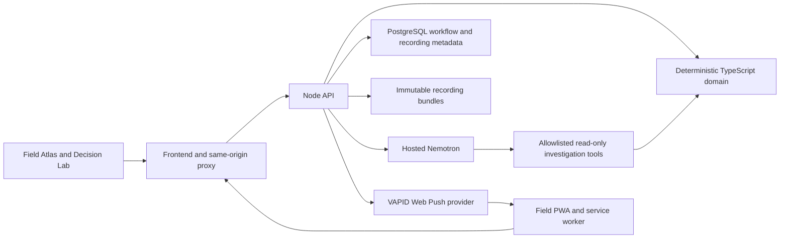

# NIGHTWATCH architecture

## Operational boundary

- `packages/domain` contains the EOG loader, detector, shutdown analysis, fleet solver, and simulator. `packages/contracts` defines the recording, plan, and shift interfaces and validates API input. The build checks that authoritative engines and Investigator code stay out of the browser bundle.
- `GET /api/datasets` lists prepared practice recordings. `POST /api/datasets/import` validates the three EOG files and archives the original bytes as a JSON bundle. `GET /api/datasets/{id}` returns normalized topology, recorded samples, and detected episodes. The selected timestamp is resolved by `GET /api/datasets/{id}/snapshot?at=…`. `POST /api/datasets/{id}/compare` returns no action, the bounded-search recommendation, and an optional operator plan. The browser uses returned frames and truck schedules to animate futures.
- Uploaded recordings require the importing browser’s HttpOnly cookie. A checksum links each archived bundle to its PostgreSQL metadata. The workflow fingerprint includes the uploaded telemetry and validated topology. The prepared official snapshots share a logical network identity so reviewing another snapshot can retain the same incident history.
- EOG forecast and replay remain tied to recorded timestamps. Work completion records a field outcome. It leaves the recording immutable. Reference answer keys are used by offline validation scripts. [EOG challenge specification](https://github.com/nihaal419/HackUTD-ZeroDay/blob/main/SPEC.md)

## Dispatch and persistence

The control room authenticates with a configured code. A scoped invitation binds a synthetic engineer to a browser session. The API checks incident stage, scope, role, revision, approved instructions, and live device availability inside the dispatch transaction. Only the current recipient can read and update the assignment. The control room refreshes workflow state every four seconds and the dispatch roster every 2.5 seconds.

The PostgreSQL migration stores people, incident cases, assignments, audit transitions, sessions, invitations, shifts, subscriptions, push attempts, and imported recording metadata in separate tables. The mutation transaction takes a workspace advisory lock and updates changed rows. A duplicate approval returns the original assignment. Local JSON is an atomic single-process fallback.

The API persists a delivery before requesting a push provider. A request marked as sent to the provider can have an uncertain final status if the process exits mid-request. A restart resumes queued deliveries. Workers can always check their inbox. The API removes expired subscriptions after a provider rejects them with 404 or 410. The service worker accepts same-origin assignment links and the API verifies the signed-in recipient before returning assignment details.

## Field Atlas design

- Light defaults use warm canvas `#F3F1EA`, paper `#FEFCF7`, ink `#203039`, water blue `#478CA1`, and brick `#A03932` for critical conditions. Night Shift uses canvas `#101F27` and surface `#1A2E36` with lighter foreground accents.
- Operations uses a compact risk strip, collapsible alert queue, 3D atlas, and contextual drawer. Equipment IDs and timestamps use monospace. Alerts use text and icons as well as color.
- Decision Lab uses a three-column plan editor, preview and evidence layout, with a shared bottom playhead. Phones collapse the editor by default and keep the playhead visible. Field uses touch targets of at least 44 CSS pixels.

## Prototype limits

- The shared control code and synthetic directory are for a controlled demonstration. The app stores device sessions for seven days. Use trusted HTTPS, protect operator credentials, and keep the database and raw archive off the public network.
- PostgreSQL serializes workspace changes and reads a workspace snapshot to reuse the tested workflow engine. The solver retains its bounded search. Large deployments would require indexed read paths and separate compute capacity.
- The database currently stores operational metadata. Validated telemetry is parsed from archived bundles, then used by the same deterministic domain engine. Tiger Data was deferred because the local setup had no TimescaleDB runtime for verifying hypertable ingestion, runtime evidence queries, and their performance. [Tiger Data hypertables](https://www.tigerdata.com/docs/learn/hypertables/creating-and-configuring-hypertables)
- The standalone API, PostgreSQL integration, and split browser workflow can be exercised locally. Docker Compose validation checks configuration. The container build and restart smoke test is included in CI.
